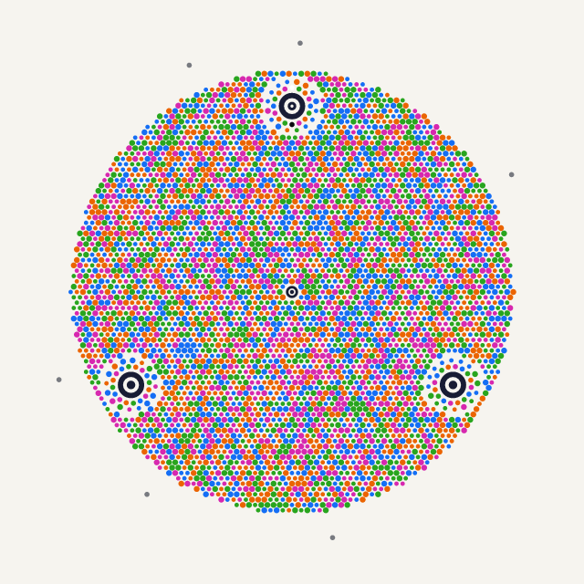
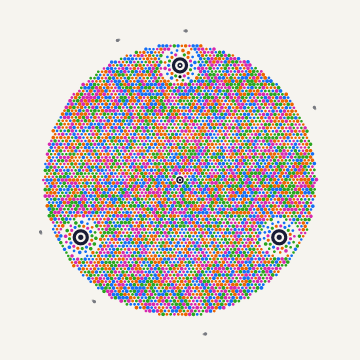
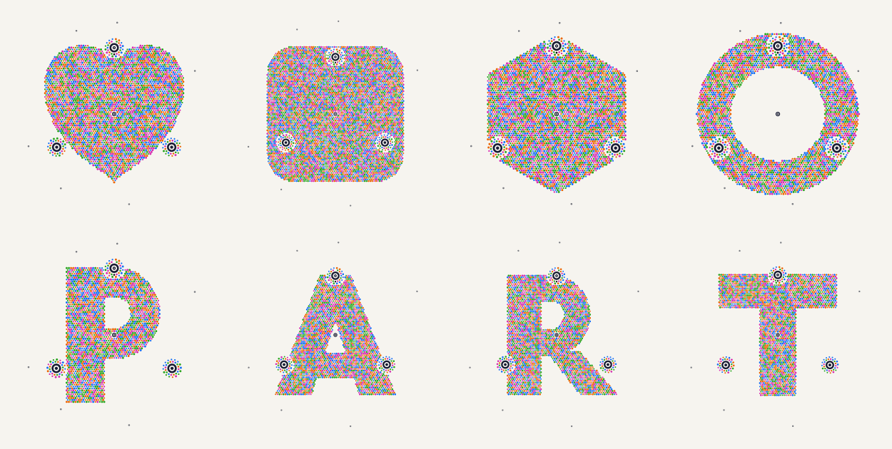
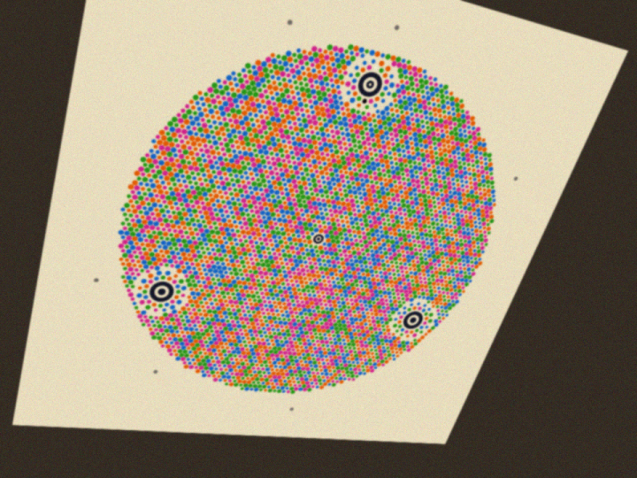
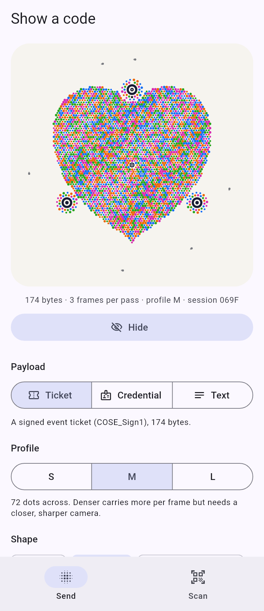

# Particle Code

**An optical code that looks like generative art.** Particle Code moves COSE/CBOR payloads
of a few hundred bytes up to several hundred kilobytes from one phone screen to another
phone's camera in a few seconds. It shows them as a living circular field of colored dots,
with a slow wave moving through it and a few drifting particles. It has no square finder
patterns and no black-and-white grid.

<p align="center">
  
  
</p>

Every frame carries one fountain-coded packet, protected by Reed-Solomon. The receiver
collects packets from any frames, in any order, until it can rebuild the payload, so a
missed frame costs one more loop of the animation, never a restart. Large payloads arrive
in segments, and each segment is verified and handed to the app as soon as it completes.

* Spec: [`docs/spec.md`](docs/spec.md)
* Implementation decisions and spec corrections: [`docs/design.md`](docs/design.md)
* Runnable examples: [`examples/`](examples/README.md)

## Shapes

The dot field can take any shape with enough ink: a disc (the default), a rounded square,
a heart, a hexagon, a ring, the letters A–Z, or your own SVG path. The anchors and halos
that the decoder locks onto are the same in every shape.

<p align="center">
  
</p>

## How it works

| Layer | What it does | Where |
| --- | --- | --- |
| Geometry | Hex lattice in pitch units. 3 hero anchors at −90°/30°/150° plus a center anchor. Each hero anchor has a halo of 16 calibration swatches and 16 header dots. Particles orbit outside all ink. | `core::layout` |
| Symbols | 4 hues × 2 sizes = 3 bits per dot. The receiver calibrates the hues from the swatches in every frame. | `core::symbol`, `core::profile` |
| Header | 96 bits (session, profile, shape, segment, packet seed, …) in RS(24,16) over GF(64), on the 48 halo dots | `core::header`, `core::rs` |
| Body | One RaptorQ symbol per frame. It is split into RS(255,191) codewords (RS(255,159) for print), interleaved and whitened across the field. | `core::body` |
| Fountain | The payload is cut into segments (8 KiB by default), each a RaptorQ block with its own CRC-32. Each pass sends K + 2 packets per segment. | `core::session`, `core::receiver` |
| Liveness | The 6 particle angles carry the packet seed and a rolling HMAC of the session key and the current second | `core::liveness` |
| Motion | Breathing wave, flow field, ripple, heartbeat, trails, reveal, cross-fade. These are pure functions of time and seed, kept inside the decoder's sampling budget. | `core::motion` |
| Vision | Finds the anchors, fits the homography and refines it with the lattice phase, calibrates color per frame, then samples and classifies the dots with confidences. Uncertain dots are passed to Reed-Solomon as erasures. | `particlecode-vision` |

| Profile | Dots across | Disc dots | Bytes / frame | 6 KB payload |
| --- | --- | --- | --- | --- |
| S | 48 | 1,821 | 506 | 13 + 2 frames |
| M (default) | 72 | 4,410 | 1,229 | 5 + 2 frames |
| L | 96 | 8,076 | 2,256 | 3 + 2 frames |

At profile M and 10 fps that is about 12 KB/s. A 6 KB COSE_Sign1 transfers in half a second
of clean frames. `cargo pc info` prints the exact numbers for every shape.

## Decoding through a (synthetic) camera

<p align="center">
  
</p>

The vision decoder is tested against synthetic camera views: tilt, rotation, blur, noise,
color casts, glare, lens distortion and lighting gradients. Typical results, measured in
release on 1080p frames at 6–9 px per pitch:

| Condition | Lock rate | Body symbol error rate |
| --- | --- | --- |
| Blur σ 1 px, noise σ 4, 15° tilt, gain 0.8 | 100 % | 0.000 % |
| Breathing wave animation (0.12 p drift) | 100 % | ≤ 0.006 % |
| Warm / dim / night-light color casts | 100 % | ≤ 0.02 % |
| Lighting gradient ±30 %, vignette | 100 % | ≤ 0.3 % |
| Large glare patch | 100 % | 1–4 % (mostly flagged as erasures) |

On one 1920×1080 frame, `locate` takes about 4 ms and `read` 30–40 ms (single thread).
These numbers come from synthetic images only. Real phone photos (JPEG, moiré, rolling
shutter) are the next step; see the build plan in the spec.

## Workspace

```
crates/particlecode-core     no_std + alloc: layout, shapes, header, RS, body codec, RaptorQ sessions, liveness, motion
crates/particlecode-vision   camera image -> header + symbols + liveness (locate, read)
crates/particlecode-render   FrameSpec -> pixels (tiny-skia): PNG, animated GIF, SVG, PNG sequence + manifest; synthetic camera
crates/particlecode-shapes   shape tool: SVG path -> lattice bitmaps, rule checks, synthetic validation, shapes.bin
crates/particlecode-cli      the `particlecode` command
crates/particlecode-ffi      the plugin's Rust side: flutter_rust_bridge API (encoder, decoder over camera frames)
flutter/particle_code/       Flutter plugin for Android and iOS (Rust built by a Native Assets hook)
examples/                    Rust examples, sample CBOR payloads, flutter-demo/ (the Flutter demo app)
fuzz/                        cargo-fuzz target for the header decoder
```

## Quick start

```sh
# Encode a payload to a PNG, an animated GIF, an SVG poster or a PNG sequence + manifest.json
cargo pc encode examples/data/credential.cbor -o out/credential.gif --all-moods
cargo pc encode examples/data/ticket.cbor -o out/poster.svg --static --prefer-shape heart
cargo pc encode examples/data/credential.cbor -o out/frames --shape P

# Decode frames back into the payload
cargo pc decode out/frames -o out/decoded.cbor

# Capacities of every shape and profile
cargo pc info

# Bring your own shape
cargo run --release -p particlecode-shapes -- check crates/particlecode-shapes/assets/star.svg
cargo run --release -p particlecode-shapes -- build crates/particlecode-shapes/assets/star.svg --id 32 -o shapes.bin
```

`cargo pc` is an alias for `cargo run --release -p particlecode-cli --`. More in
[`examples/README.md`](examples/README.md).

### As a library

```rust
use particlecode_core::{DisplayInfo, Progress, Receiver, Session, SessionConfig};

let display = DisplayInfo { width_px: 1080, height_px: 2400, width_mm: 68.0, height_mm: 151.0 };
let session = Session::new(&payload, display, &SessionConfig::default())?;

// Sender: draw `session.frame(i)` (a plain-data FrameSpec) every 100 ms.
// Receiver: per camera frame
let mut rx = Receiver::new();
if let Some(lock) = particlecode_vision::locate(&yuv.y) {
    let (header, body, _liveness) =
        particlecode_vision::read(&yuv, &lock, &|p, s| rx.dot_order(p, s))?;
    if let Progress::Done(bytes) = rx.feed_decoded(&header, &body) { /* … */ }
    // `rx.take_ready()` streams verified segments in order while the rest arrives.
}
```

## Flutter

[`flutter/particle_code`](flutter/particle_code) is the Flutter plugin for Android and iOS, and the
only way an app uses Particle Code. Dart reaches Rust through
[flutter_rust_bridge](https://pub.dev/packages/flutter_rust_bridge), nothing else:

* **Sender.** Frames are built by the Rust encoder on Rust threads and painted in Dart.
* **Scanner.** The plugin's native code runs the camera (CameraX, AVFoundation: preview, focus,
  torch) and hands each frame to Dart **by address**. Dart passes the addresses to the Rust
  decoder, which reads the planes in place on a worker thread, then tells the native side to
  release the frame. Pixels are never copied; only the newest frame is decoded.
* **Build.** The plugin's [Native Assets](https://docs.flutter.dev/platform-integration/bind-native-code)
  hook (`hook/build.dart`) compiles `crates/particlecode-ffi` with cargo for every target the
  app is built for and bundles it. `flutter run` and `flutter build` just work once `rustup` is
  installed; there is no prebuilt binary and no build script.



```dart
import 'package:particle_code/particle_code.dart';

// Once, before using the sender or the scanner (loads the Rust library).
await ParticleCode.init();

// Sender: show a payload as an animated field of dots.
final encoder = ParticleEncoder.create(
  cborBytes,
  options: const EncoderOptions(profile: CodeProfile.m, shape: Shape.heart),
);
ParticleCodeView(encoder: encoder, size: 320, motion: const MotionConfig());

// Scanner: camera preview with anchors and progress, then the payload.
final scanner = ParticleScanner();
scanner.events.listen((e) {
  if (e is ScanDone) handle(e.payload);
});
if (await scanner.requestPermission()) await scanner.start();
// ... ParticleScannerPreview(scanner: scanner)
```

See the [plugin README](flutter/particle_code/README.md) and
[`PROTOCOL.md`](flutter/particle_code/PROTOCOL.md) (the native/Dart frame handoff). The
[demo app](examples/flutter-demo) has a Send tab (sample ticket and credential or free
text, profile, shape, mood) and a Scan tab (camera, progress, result sheet), and
`.github/workflows/flutter.yml` builds it for Android and iOS on every pull request.

## Development

The toolchain is pinned in `rust-toolchain.toml`. Before every commit, run what CI runs:

```sh
cargo fmt --all --check
cargo lint          # clippy --workspace --all-targets --all-features -D warnings (pedantic)
cargo t             # test --workspace --all-features
cargo deny check    # licenses, advisories, bans, sources (deny.toml)
cargo build -p particlecode-core --no-default-features   # core stays no_std
```

The repo ships Claude Code skills in `.claude/skills/`: `rust-practices`,
`cargo-workflow`, `cargo-deny` and `particlecode-format`. See [`CLAUDE.md`](CLAUDE.md).

## License

MIT, see [`LICENSE`](LICENSE).
