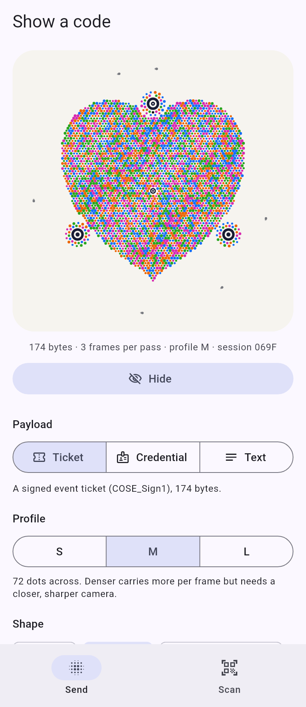

# Particle Code Flutter demo

Sender and scanner demo for the [`particle_code`](../../flutter/particle_code/README.md) plugin (Android and iOS).

* **Send** tab: pick a payload (a ~200 byte ticket, a ~6 KB credential, or free text), a
  profile (S, M, L), a shape (disc, heart, rounded square, hexagon, ring, a letter) and a mood
  (breathing or flow field, plus trails, heartbeat and reveal), then show the code. The screen
  goes to full brightness while it shows; **Hide** restores it.
* **Scan** tab: asks for the camera, shows the native preview with the lock anchors, the live
  hint, bytes received so far, a progress ring and a torch toggle. A finished scan opens a
  result sheet (size, hex, text if it is UTF-8, liveness) with **Scan again**.



## Run it

```sh
cd examples/flutter-demo
flutter run            # on a phone: the simulator and emulator have no camera
```

The first build compiles the Rust library through the plugin's Native Assets hook, which needs
`rustup` (and Xcode for iOS, the Android NDK for Android, as any Flutter build with native
code); later builds reuse it.

The iOS deployment target is 15.0, the lowest Flutter 3.47 accepts (it rewrites anything
lower), and the plugin's minimum too.

On iOS the app builds through Swift Package Manager (Flutter's default) and has no Podfile: its
Xcode project carries Flutter's SwiftPM integration. Apps still on CocoaPods use the plugin's
podspec instead; CI covers that path by building a fresh app created with SwiftPM disabled.

## Tests

```sh
flutter test           # builds the Rust library for the host first
```

`test/send_tab_test.dart` drives the Send tab with the real encoder through flutter_rust_bridge (the test calls `ParticleCode.init()`; so does `main()`).
`test/scan_tab_test.dart` mocks the plugin's platform channels.

`tool/screenshot_test.dart` renders the picture above (`flutter test tool/screenshot_test.dart`).
CI checks a built iOS app with the plugin's `tool/check_ios_app.sh`: the app embeds
`particlecode_ffi.framework` and it exports the flutter_rust_bridge entry points.
