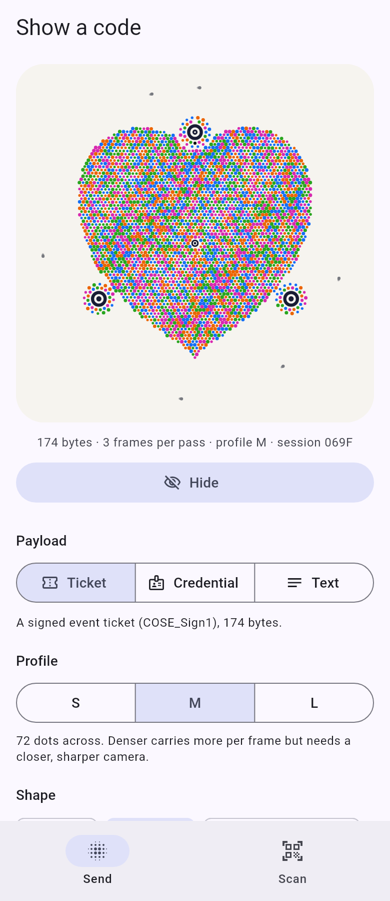

# particle_code example

Sender and scanner demo for the [`particle_code`](../README.md) plugin (Android and iOS).

* **Send** tab: pick a payload (a ~200 byte ticket, a ~6 KB credential, or free text), a
  profile (S, M, L), a shape (disc, heart, rounded square, hexagon, ring, a letter) and a mood
  (breathing or flow field, plus trails, heartbeat and reveal), then show the code. The screen
  goes to full brightness while it shows; **Hide** restores it.
* **Scan** tab: asks for the camera, shows the native preview with the lock anchors, the live
  hint, bytes received so far, a progress ring and a torch toggle. A finished scan opens a
  result sheet (size, hex, text if it is UTF-8, liveness) with **Scan again**.



## Run it

The plugin does not build the Rust libraries; do that once from the repository root.

```sh
# Android (needs the NDK and cargo-ndk)
scripts/build-android.sh --debug

# iOS (needs a Mac with Xcode)
scripts/build-xcframework.sh --flutter

cd flutter/particle_code/example
flutter run            # on a phone: the simulator and emulator have no camera
```

The iOS deployment target is 15.0, the lowest Flutter 3.47 accepts (it rewrites anything
lower), and the plugin's minimum too. The Release configuration sets
`STRIP_STYLE = non-global` so the `pc_*` functions that only Dart calls survive stripping.

On iOS the app builds through Swift Package Manager (Flutter's default) and has no Podfile: its
Xcode project carries Flutter's SwiftPM integration. Apps still on CocoaPods use the plugin's
podspec instead; CI covers that path by building a fresh app created with SwiftPM disabled.

## Tests

```sh
cargo build -p particlecode-ffi   # host library for the encoder tests
flutter test
```

`test/send_tab_test.dart` drives the Send tab with the real encoder through flutter_rust_bridge (the test calls `ParticleCode.init()`; so does `main()`).
`test/scan_tab_test.dart` mocks the plugin's platform channels.

`tool/screenshot_test.dart` renders the picture above (`flutter test tool/screenshot_test.dart`),
and `tool/check_ios_symbols.sh` is the CI check that a built iOS app contains the `dart:ffi`
symbols.
